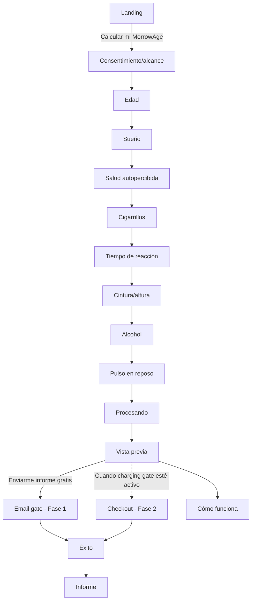
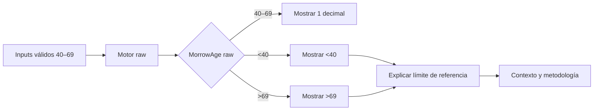
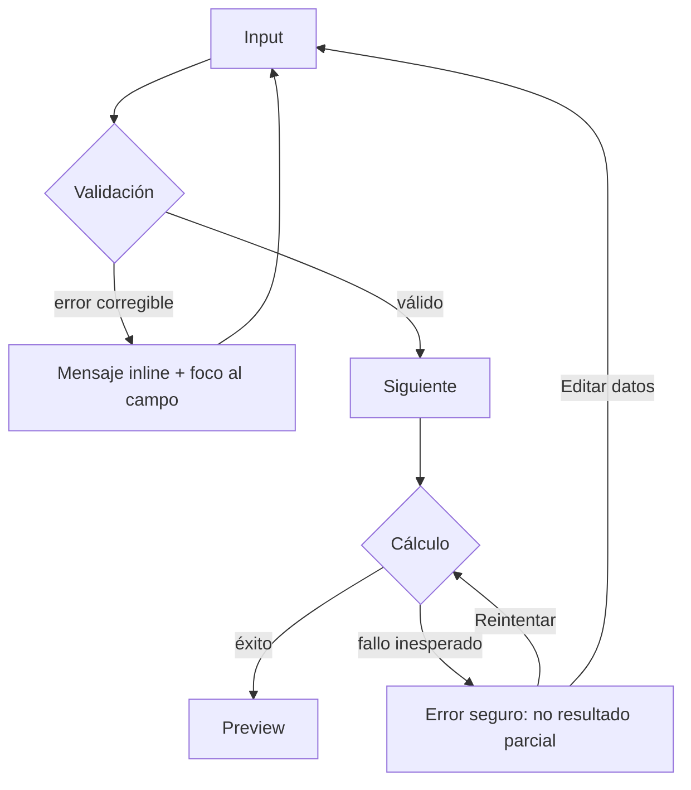

# Sitemap y flujos · MorrowAge

## Rutas

| Ruta | Objetivo | Indexación |
|---|---|---|
| `/` | Landing principal | index |
| `/calculate` | Inicio calculadora | noindex |
| `/calculate/:step` | 8 pasos | noindex |
| `/processing` | transición de cálculo | noindex |
| `/preview/:session` | resultado gratuito | noindex, token opaco |
| `/report-request` | email gate Fase 1 | noindex |
| `/checkout` | pago Fase 2, solo tras activación | noindex |
| `/success` | confirmación | noindex |
| `/report/:token` | informe web | noindex, token opaco/expirable |
| `/how-it-works` | metodología comprensible | index |
| `/methodology` | metodología técnica/fuentes | index |
| `/faq` | objeciones y seguridad | index |
| `/privacy` | privacidad | index |
| `/terms` | términos | index |
| `/admin` | métricas operativas agregadas | auth + noindex |

### SEO localizado
- `/{locale}/risk-equivalent-age-calculator`
- `/{locale}/country/{country}/risk-equivalent-age`
- `/{locale}/guides/{use-case}`

`locale ∈ {es,en,pt}`. Las páginas de país deben incluir un aviso visible: **“El modelo no está calibrado específicamente para este país”** hasta superar validación local; no usar percentiles ni claims de superioridad nacionales.

## Flujo principal

## Flujo de resultado fuera del rango de referencia

## Flujo de error

## Flujo Fase 1 → Fase 2
Fase 1 permanece gratuita hasta cumplir los thresholds definidos en `monetizacion.json` durante dos cohortes semanales consecutivas y no existir blocker material de seguridad/QA. El PRD debe mantener `checkout` detrás de feature flag. La URL puede existir técnicamente, pero no debe ser reachable para usuarios mientras la flag esté desactivada.
