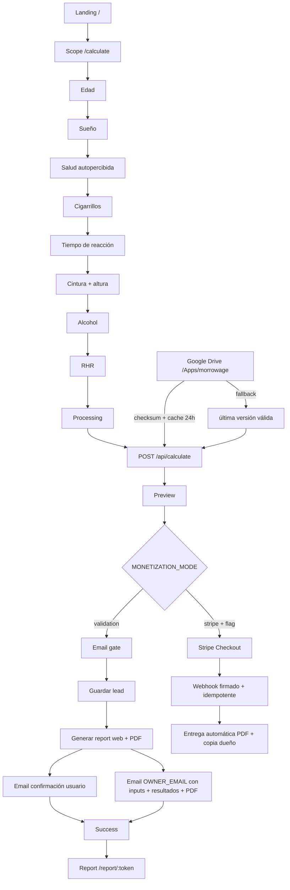

# PRD · MorrowAge

## 0. Ficha y versión

| Campo | Valor |
|---|---|
| Producto | MorrowAge |
| Slug | `morrowage` |
| PRD | v4.0 |
| Modelo/wrapper | v2.1 |
| Estado | READY_TO_BUILD |
| Etapa de fábrica | 4 |
| Fecha | 2026-10-06 |
| Idiomas | Español, inglés, portugués |
| Rango de uso v1 | 40–69 años |
| MONETIZATION_MODE inicial | `validation` |
| Stack objetivo | Next.js App Router + TypeScript strict + Supabase + Google Drive + Resend + React PDF |
| Fuente canónica de cálculo | `model/engine_reference.py`, `spec/model_spec.json`, `spec/test_vectors.json` |
| UX canónica | `ux/ux_spec.md`, `ux/components.md`, `ux/sitemap_flows.md`, `spec/design_tokens.json`, `spec/copy_i18n.json` |

**Definición del producto.** MorrowAge convierte ocho datos cotidianos en una **edad equivalente de riesgo poblacional** frente al benchmark del mismo modelo. No es edad biológica, diagnóstico, predicción cierta de longevidad ni probabilidad absoluta de mortalidad a 10 años.

**Reglas canónicas de Etapa 4.** Se preserva el wrapper v2.1; la salida raw puede existir para auditoría interna, pero la UI censura fuera de 40–69 como `<40` o `>69`. La sensibilidad es un escenario de medición bounds-aware, nunca un intervalo de confianza. Los percentiles por país y la mortalidad absoluta a 10 años permanecen bloqueados. En analítica y `/admin` no se envían inputs de salud, resultados crudos ni URLs/tokens de informes. En `validation`, el correo operacional a `OWNER_EMAIL` contiene los inputs, resultados y PDF completo exigidos por el protocolo de validación, y debe tratarse como dato sensible con acceso mínimo, transporte cifrado y retención operativa limitada.

## 1. Resumen ejecutivo

MorrowAge es una web móvil-first para adultos de 40–69 años que quieren una señal rápida y auditable sobre cómo su perfil se compara con un benchmark poblacional. El usuario completa un assessment de ocho inputs en menos de 90 segundos, recibe una vista previa gratuita con `morrow_age_display`, hazard relativo secundario y un driver principal, y puede solicitar el informe completo.

El MVP se lanza con `MONETIZATION_MODE=validation`: no cobra. La vista previa lleva a un gate de email explícito. La solicitud crea un lead, genera el informe web/PDF, envía confirmación al usuario y envía al dueño una notificación operacional con el detalle de la solicitud y el PDF. Stripe existe detrás de feature flag y solo se activa cuando se alcanzan umbrales de tracción y no hay blockers de seguridad, legal o modelo.

El diferenciador es la combinación de fricción baja, cálculo determinista reproducible, fuentes visibles, límites explícitos y una experiencia que evita lenguaje clínico o causal. La implementación debe poder desplegarse en Vercel desde GitHub; Netlify es alternativa compatible. Los archivos de configuración y referencia del modelo se sincronizan desde Google Drive `/Apps/morrowage/`, se validan por SHA-256, se cachean 24 horas y se conserva la última versión válida si Drive falla.

## 2. Problema y evidencia

El problema de usuario no es la falta de métricas sino la dificultad de convertir hábitos y mediciones dispersas en una señal comprensible, contextualizada y suficientemente confiable como para decidir el siguiente paso. El brief de Etapa 1 documenta señales de necesidad estructural: carga global de enfermedades no transmisibles, brecha entre esperanza de vida y vida saludable, alta prevalencia de inactividad, hipertensión y exceso de peso, y disposición de pago demostrada por alternativas de longevidad con precios muy superiores.

La demanda por “biological age” y conceptos afines aparece en búsquedas, comunidades de quantified self y productos de laboratorio. Esas señales son direccionales: los volúmenes SEO son estimaciones de terceros y deben tratarse como **preliminares** hasta revalidarlos con herramientas directas.

La evidencia de mercado y sus fuentes se conserva en `docs/brief_estrategico.md` y `01_estrategia/fuentes_mercado.csv`. La evidencia del modelo se conserva en `model/model_card.md`, `spec/model_spec.json` y `02_datos_modelo/fuentes_datos.csv`.

## 3. Mercado y segmentos

Segmentos prioritarios:
1. **Longevity-curious professionals, 40–54 dentro del rango v1.** Buscan una señal cuantificada sin pagar cientos de dólares ni usar laboratorio.
2. **Prevention-minded adults, 50–69.** Quieren traducir hábitos y mediciones simples a una señal entendible.
3. **Quantified-self / fitness optimizers, 40–49 dentro del rango v1.** Ya siguen métricas y valoran transparencia, tracking y auditabilidad.

Las estimaciones de tamaño del brief son top-down y no censales. Se usarán como hipótesis de adquisición, no como TAM certificado. El MVP se puede adquirir globalmente en ES/EN/PT, pero no debe presentar calibración nacional ni percentiles hasta validación local. Estados Unidos es el mercado comercial primario de validación; UK, Canadá, Australia, Brasil y Perú/LatAm son extensiones posteriores condicionadas.

## 4. Persona y JTBD

**Persona principal: Alex, 44.** Profesional con ingresos medios-altos, usa apps de fitness, siente curiosidad por longevidad, no se considera enfermo y no quiere empezar con una prueba de laboratorio costosa.

**JTBD:** “Cuando empiezo a preocuparme por cómo estoy envejeciendo, quiero convertir mis hábitos en una cifra creíble y entendible, para priorizar qué revisar y decidir si necesito una evaluación más profunda.”

**Ansiedades.** “¿Esto es real o un quiz?”, “¿me está diciendo cuándo moriré?”, “¿por qué una variable se mueve en una dirección contraintuitiva?”, “¿qué pasa con mis datos?”. El producto responde con metodología visible, lenguaje poblacional, asociación ≠ causalidad y minimización de datos.

## 5. Competencia

Las alternativas del brief se agrupan en: tests epigenéticos caros, plataformas de biomarcadores con laboratorio, membresías de salud longitudinal y calculadoras gratuitas de estilo de vida. El hueco del MVP es una evaluación instantánea, sin laboratorio, de bajo costo futuro y con cálculo reproducible.

MorrowAge no compite afirmando mayor precisión clínica. Compite en fricción, transparencia y contexto. La tabla de competidores, precios y fuentes se mantiene en `docs/brief_estrategico.md`; los precios de terceros deben revalidarse antes de publicación comparativa.

## 6. Propuesta de valor

**ES:** “8 datos. Menos de 90 segundos. Una edad equivalente de riesgo con contexto y fuentes visibles.”

**EN:** “8 inputs. Under 90 seconds. A risk-equivalent age with context and visible sources.”

**PT:** “8 dados. Menos de 90 segundos. Uma idade equivalente de risco com contexto e fontes visíveis.”

Promesa funcional: cálculo determinista + preview inmediato + informe contextual. Promesa de confianza: metodología visible, límites explícitos, sin claims de edad biológica, sin LLM para la cifra numérica y sin vender outputs bloqueados.

## 7. Alcance MVP, fuera de alcance y v2

**MVP incluido:** landing SEO; assessment de 8 pasos; consentimiento de alcance; reacción integrada; conversiones de unidad; cálculo v2.1; preview segura; email gate; lead; informe web y PDF; Resend; notificación operacional al dueño; admin mínimo; analítica del funnel; Drive runtime; i18n ES/EN/PT; privacidad y borrado; Turnstile/rate limit; Sentry/PostHog; CI; Stripe detrás de feature flag.

**Fuera de alcance:** diagnóstico, tratamiento, suplementos, triage, chat médico, riesgo absoluto a 10 años, percentiles nacionales, edades fuera de 40–69, menores, embarazo, enfermedad terminal como población objetivo, underwriting/empleo/crédito, integración obligatoria con wearables, laboratorio, ADN/epigenética y recomendaciones causales derivadas del signo de coeficientes.

**V2:** tracking longitudinal; re-tests; suscripción si hay retorno voluntario; wearables opcionales si aportan lift; calibración por país; benchmarks locales validados; B2B2C de wellness con restricciones; Stripe activo si la tracción lo justifica.

## 8. Flujo end-to-end



## 9. Historias de usuario US-xx con Gherkin

### US-01 · Entender la propuesta y comenzar
**Como** visitante, **quiero** entender qué calcula MorrowAge y qué no, **para** decidir si empiezo sin confundirlo con una prueba clínica.

```gherkin
Dado que visito la landing en ES, EN o PT
Cuando leo el hero y el bloque de confianza
Entonces veo que el resultado es una edad equivalente de riesgo poblacional
Y veo que no es edad biológica, diagnóstico ni predicción de longevidad
Y el CTA primario inicia el assessment
```

### US-02 · Aceptar alcance antes de aportar datos
```gherkin
Dado que inicié el assessment
Cuando se muestra la pantalla de alcance
Entonces veo el rango 40–69 y el uso educativo
Y debo aceptar el alcance antes de continuar
```

### US-03 · Completar ocho inputs válidos
```gherkin
Dado que acepté el alcance
Cuando avanzo por los ocho pasos
Entonces cada dato se valida contra spec/inputs.schema.json
Y los errores son inline y accesibles
Y no se precompletan respuestas de salud
```

### US-04 · Medir reacción de forma integrada
```gherkin
Dado que llego al paso de reacción
Cuando ejecuto la prueba
Entonces se registra un valor válido en milisegundos
Y analytics solo recibe versión de protocolo y buckets, nunca el valor crudo
```

### US-05 · Obtener una vista previa reproducible
```gherkin
Dado que los ocho inputs son válidos
Cuando se ejecuta el motor
Entonces el resultado coincide con el wrapper v2.1
Y se muestran edad equivalente segura, edad cronológica, un driver y contexto
Y el hazard relativo no es el headline
```

### US-06 · Ver un resultado fuera del rango sin falsa precisión
```gherkin
Dado que el MorrowAge raw cae fuera de 40–69
Cuando veo preview o informe
Entonces veo <40 o >69
Y nunca veo el valor raw exacto fuera del rango
```

### US-07 · Solicitar el informe gratis en validation
```gherkin
Dado que MONETIZATION_MODE es validation
Cuando envío un email válido y consentimiento de servicio
Entonces se crea un lead
Y marketing permanece opcional y separado
Y no se cobra
```

### US-08 · Recibir informe web y PDF
```gherkin
Dado que mi solicitud fue aceptada
Cuando se genera el informe
Entonces recibo un email de confirmación
Y puedo abrir un enlace opaco y expirable
Y puedo descargar el PDF completo
```

### US-09 · Notificar al dueño en validation
```gherkin
Dado que se crea una solicitud de informe
Cuando termina la generación
Entonces OWNER_EMAIL recibe asunto "[MorrowAge] Solicitud de informe <id>"
Y el mensaje contiene inputs, resultados y el PDF completo
Y esos datos no se copian a PostHog ni al dashboard admin
```

### US-10 · Consultar metodología y límites
```gherkin
Dado que veo un resultado
Cuando abro metodología
Entonces veo fuente del modelo, benchmark, versión, limitaciones y outputs bloqueados
Y c-statistic 0.74 no se presenta como 74% accuracy
```

### US-11 · Ejercer borrado
```gherkin
Dado que tengo un informe o lead
Cuando inicio una solicitud de borrado
Entonces el sistema registra la petición
Y permite resolver la supresión según obligaciones legales y de retención aplicables
```

### US-12 · Operar leads desde admin mínimo
```gherkin
Dado que soy administrador autenticado
Cuando abro /admin
Entonces veo leads, estados de embudo y reenvío
Y no veo inputs de salud, resultados crudos ni report URLs
```

### US-13 · Cobrar solo cuando Stripe está activado
```gherkin
Dado que MONETIZATION_MODE=stripe y la feature flag está activa
Cuando compro el informe
Entonces Stripe crea un checkout
Y el webhook se verifica por firma y es idempotente
Y el PDF se entrega automáticamente tras pago confirmado
```

### US-14 · Usar la app en ES, EN o PT
```gherkin
Dado que cambio de locale
Cuando navego por rutas públicas, assessment e informe
Entonces copy, formatos y metadata se adaptan
Y no cambia el resultado numérico del motor
```

### US-15 · Usar la app con accesibilidad AA
```gherkin
Dado que navego con teclado o lector de pantalla
Cuando completo el flujo
Entonces puedo operar todas las acciones
Y los gráficos tienen equivalente textual/tabular
Y los errores se anuncian sin depender solo de color
```

### US-16 · Sobrevivir a un fallo de Google Drive
```gherkin
Dado que existe una versión Drive previamente validada
Cuando Drive no responde o el checksum falla
Entonces la app usa la última versión válida cacheada
Y Sentry registra el fallo sin exponer datos sensibles
```

### US-17 · Explorar escenarios sin causalidad
```gherkin
Dado que accedo al informe completo
Cuando modifico hasta tres inputs dentro de guardrails
Entonces veo el recálculo como escenario educativo
Y no se generan recomendaciones automáticas que sugieran fumar, beber más o dormir menos
```

## 10. Requisitos FR-xx y NFR-xx

### Requisitos funcionales

| ID | Requisito |
|---|---|
| FR-01 | Renderizar landing, assessment, preview, gate, report, metodología, FAQ y legal en ES/EN/PT con `next-intl`. |
| FR-02 | Validar los 8 inputs exactamente contra `spec/inputs.schema.json`. |
| FR-03 | Normalizar unidades físicas y alcohol antes del motor sin alterar guardrails canónicos. |
| FR-04 | Implementar test de reaction time versionado; valor final 250–1500 ms. |
| FR-05 | Portar `model/engine_reference.py` a TypeScript sin cambiar matemática; `spec/test_vectors.json` debe pasar 18/18. |
| FR-06 | Aplicar `morrow_age_display` seguro: exacto solo 40–69; `<40`/`>69` fuera. |
| FR-07 | Preview gratis incluye los outputs definidos como `free_preview` en `spec/outputs_spec.json`. |
| FR-08 | Gate validation captura email, consentimiento de servicio y marketing opcional separado. |
| FR-09 | Persistir leads, cálculos y pedidos en Supabase con separación de datos sensibles y RLS. |
| FR-10 | En validation, Resend envía confirmación al usuario. |
| FR-11 | En validation, Resend envía a `OWNER_EMAIL` asunto `[MorrowAge] Solicitud de informe <id>`, inputs, resultados y PDF completo; prohibido replicar ese payload a analytics/admin. |
| FR-12 | Generar informe web y PDF con `@react-pdf/renderer` conforme a `ux/report_layout.md`. |
| FR-13 | Los tokens de informe son aleatorios, se almacenan hasheados y expiran según `REPORT_TOKEN_TTL_HOURS`. |
| FR-14 | `/admin` muestra leads, funnel y acción de reenvío; no expone inputs/resultados/tokens. |
| FR-15 | Emitir solo eventos y propiedades permitidos por `spec/analytics_events.json`. |
| FR-16 | Leer `/Apps/morrowage/` por nombre de archivo, comprobar checksum de `spec/drive_manifest.json`, cachear 24 h y usar última versión válida ante fallo. |
| FR-17 | Implementar `npm run drive:sync` para subir `drive/` a `GOOGLE_DRIVE_FOLDER_ID` conservando estructura. |
| FR-18 | Publicar metodología y model card desde archivos canónicos sin inventar claims. |
| FR-19 | Implementar flujo de solicitud de borrado y trazabilidad operacional. |
| FR-20 | Stripe permanece detrás de `MONETIZATION_MODE=stripe` y `STRIPE_ENABLED=true`. |
| FR-21 | Webhook Stripe firmado e idempotente; no entregar por evento duplicado. |
| FR-22 | Soportar lista de espera de suscripción sin activar cobro recurrente en MVP. |
| FR-23 | Proteger endpoints de gate/report/admin con Turnstile cuando aplique y rate limit. |
| FR-24 | Publicar SEO indexable solo en landing, how-it-works, methodology, FAQ, legal y contenidos localizados permitidos. |
| FR-25 | Mantener `mortality_risk_10y` y `country_percentile` bloqueados hasta que un cambio versionado de spec los habilite. |
| FR-26 | Asignar Verification ID y model/app version a cada informe. |

### Requisitos no funcionales

| ID | Requisito / criterio |
|---|---|
| NFR-01 Rendimiento | p95 de route handlers interactivos <2 s en producción, excluyendo latencia de checkout externo; cálculo puro objetivo <50 ms. |
| NFR-02 Lighthouse | Lighthouse móvil >=90 en Performance, Accessibility, Best Practices y SEO en rutas públicas críticas. |
| NFR-03 Seguridad | TypeScript strict, validación server-side, CSP, HSTS, cookies seguras, CSRF donde aplique, secretos solo server, firma Stripe, Turnstile, rate limit, dependencias auditadas. |
| NFR-04 Privacidad | Minimización, purpose limitation, separación analytics/operación, tokens opacos, retención configurable, DSR, no PII/health payload en logs. |
| NFR-05 Accesibilidad | WCAG 2.2 AA, teclado completo, focus visible, touch target >=44×44 px, `aria-live`, tablas alternativas para gráficos. |
| NFR-06 i18n | Paridad funcional ES/EN/PT; locale estable en URL/cookie; números/unidades localizados sin cambiar inputs canónicos del motor. |
| NFR-07 Costo | En validation, costo incremental objetivo de generación+email <=US$0.05 por informe fuera de planes fijos. En stripe, mantener costo variable modelado <=US$1 por informe de US$19 antes de impuestos, soporte, chargebacks y costos fijos. |
| NFR-08 Resiliencia | Drive: última versión válida; email: retry controlado; webhook idempotente; errores del motor no muestran parciales. |
| NFR-09 Observabilidad | Sentry para excepciones/performance y PostHog para funnel; scrub de PII y datos de salud. |
| NFR-10 Testabilidad | Vitest unit/integration + Playwright e2e; `test_vectors.json` obligatorio en CI. |
| NFR-11 Mantenibilidad | decisiones nuevas en `DECISIONS.md`, no duplicar constantes de modelo, schemas versionados y API OpenAPI 3.1. |

## 11. Inputs

La definición exhaustiva vive en `spec/inputs.schema.json` y la UX asociada en `ux/ux_spec.md`. La implementación **no debe duplicar ni reinterpretar rangos** en componentes; los formularios consumen un adaptador tipado generado desde el schema.

Inputs canónicos: `age_years`, `sleep_hours`, `self_rated_health`, `cigarettes_per_day`, `reaction_time_ms`, `waist_to_height_ratio`, `alcohol_units_week`, `resting_hr_bpm`.

La UI puede capturar cintura/altura en cm o pulgadas y alcohol en formatos locales, pero antes del cálculo debe normalizar a WHtR y UK units/week. Ningún default puede inferir una respuesta de salud.

## 12. Modelo

Fuente de verdad: `spec/model_spec.json`, `model/engine_reference.py`, `model/qa_engine.py`, `model/model_card.md` y `spec/test_vectors.json`.

La implementación TypeScript debe ser una traducción directa del wrapper v2.1. El cálculo principal produce hazard relativo frente al benchmark y MorrowAge mediante inversión del término de edad del Cox publicado. No se usa LLM. No se implementa el C-Score propietario. La supervivencia basal a 10 años no está disponible en la fuente seleccionada y no se inventa.

## 13. Base de datos y Drive

El esquema SQL completo y RLS están en `spec/db_schema.sql`. La interfaz HTTP está en `spec/openapi.yaml`.

Drive se gobierna por `spec/drive_manifest.json` y el contenido exacto de `drive/`. La app usa una service account, resuelve los archivos bajo `/Apps/morrowage/`, verifica SHA-256, cachea 86,400 s y mantiene un snapshot de última versión válida. El procedimiento de configuración está en `docs/DRIVE_SETUP.md`.

Supabase almacena: cálculos sensibles de retención corta, leads, informes/tokens, pedidos, eventos de webhook y solicitudes de borrado. El dashboard admin no consulta directamente la tabla de cálculos sensibles.

## 14. Outputs y niveles de acceso

La lista autoritativa vive en `spec/outputs_spec.json`. Reglas:
- Gratis: `morrow_age_display`, `morrow_age_status`, `relative_hazard`, `preview_chart`, `preview_driver`.
- Informe completo: `measurement_sensitivity_range`, `all_drivers`, `what_if_scenarios`, `action_plan`, `methodology`.
- Condicional/bloqueado: `country_percentile` solo tras validación local; `mortality_risk_10y` bloqueado hasta recalibración.
- La UI nunca muestra raw MorrowAge exacto fuera de 40–69.

## 15. UX/UI

Especificación canónica: `ux/ux_spec.md`, `ux/components.md`, `ux/sitemap_flows.md`, `spec/design_tokens.json`, `spec/copy_i18n.json`, `ux/prototype.html`.

Principios que no se negocian: un CTA primario por pantalla; calma científica; sin semáforo clínico; labels persistentes; errores inline; diseño móvil-first; 8 pasos visibles; resultados con whitespace; hazard relativo secundario; fuentes y limitaciones cerca del resultado; reduced motion.

El prototipo es referencia funcional y visual, no código production-ready.

## 16. Informe PDF

Layout autoritativo: `ux/report_layout.md`. Máximo recomendado v1: 8 páginas. El PDF refleja el informe web y no introduce claims adicionales. Se genera con `@react-pdf/renderer`, incluye Verification ID, model version, fecha, locale, resumen, significado/no-significado, sensibilidad, drivers, escenarios, metodología, fuentes, privacidad y disclaimer.

Todos los gráficos tienen alternativa textual/tabular. Fuera de 40–69 se usa boundary marker y `<40`/`>69`. “Sensibilidad de medición” lleva nota explícita “No es un intervalo de confianza”.

## 17. Monetización y tracción

`MONETIZATION_MODE=validation` por defecto.

**Validation:** preview gratis → formulario “Recibe tu informe completo” → lead → confirmación usuario → email dueño con asunto `[MorrowAge] Solicitud de informe <id>`, inputs, resultados y PDF → informe accesible por token expirable. Puede existir un checkbox separado para lista de espera de suscripción.

**Stripe:** activar solo con `MONETIZATION_MODE=stripe` y `STRIPE_ENABLED=true`. Checkout one-time, webhook firmado e idempotente, entrega automática del PDF y copia al dueño. Precio US$19 es hipótesis inicial; precios locales del spec no son PPP verificado.

**Umbral operativo mínimo para considerar cobro:** preview→email >=25% y >=50 solicitudes calificadas en 14 días, sin blocker material. Además se revisan los thresholds del `spec/monetizacion.json`: completion, gate conversion, open rate y WTP; la decisión de activar cobro requiere evidencia consistente en dos cohortes semanales.

## 18. Emails

Plantillas transaccionales en ES/EN/PT:
- Usuario validation: confirmación de solicitud + enlace expirable al informe.
- Owner validation: `[MorrowAge] Solicitud de informe <id>`; incluye locale, consent timestamps, inputs canónicos, outputs seguros/raw para auditoría operacional y PDF completo. No incluir estos datos en asunto, analytics ni logs.
- Stripe: confirmación de pago + enlace y PDF; copia al dueño.
- Reenvío admin: reproduce el correo de entrega y registra `last_sent_at`.

SPF/DKIM/DMARC deben estar configurados antes de tráfico real. `EMAIL_FROM` usa dominio propio verificado.

## 19. Arquitectura y stack

- Next.js App Router, React, TypeScript `strict`.
- Tailwind CSS + shadcn/ui.
- Route Handlers como API; no FastAPI salvo que una dependencia Python/ONNX sea imprescindible, lo cual no aplica a v2.1.
- Motor TypeScript portado desde `engine_reference.py`.
- Supabase Postgres + RLS; Supabase Auth solo para admin.
- Google Drive API con service account; checksum, cache 24 h y last-known-good.
- Resend para email.
- `@react-pdf/renderer` para PDF.
- `next-intl` ES/EN/PT.
- PostHog + Sentry con scrubbing.
- Cloudflare Turnstile.
- Rate limiting server-side con proveedor Redis compatible o implementación persistente equivalente; la referencia usa variables `UPSTASH_REDIS_REST_URL` y `UPSTASH_REDIS_REST_TOKEN`.
- Vitest + Playwright.
- GitHub Actions.
- Stripe detrás de feature flag.
- Despliegue principal Vercel; Netlify como alternativa si soporta los route handlers y runtime de PDF requerido.

## 20. API (OpenAPI 3.1)

Contrato completo en `spec/openapi.yaml`. Endpoints mínimos:
- `POST /api/calculate`
- `POST /api/leads`
- `GET /api/report/{token}`
- `GET /api/report/{token}/pdf`
- `POST /api/privacy/delete-request`
- `GET /api/admin/leads`
- `GET /api/admin/funnel`
- `POST /api/admin/reports/{id}/resend`
- `POST /api/stripe/checkout`
- `POST /api/stripe/webhook`
- `GET /api/health`

Los endpoints públicos aplican validación Zod/JSON Schema, límites de tamaño, rate limit y Turnstile en operaciones abusables. Las respuestas no devuelven secretos ni trazas.

## 21. Modelo de datos con RLS

Definido en `spec/db_schema.sql`. Principios:
- `calculations` contiene payload de salud y resultado solo durante retención operativa; no es seleccionable por anon ni por el rol admin de frontend.
- `leads` contiene email y consentimientos separados.
- `reports` guarda token hash, expiración y Verification ID, nunca token plano.
- `orders` y `stripe_webhook_events` garantizan idempotencia.
- `deletion_requests` registra derechos del titular.
- `admin_users` limita el dashboard.
- Todas las tablas tienen RLS. El service role se usa exclusivamente en route handlers server-side.

## 22. Seguridad, privacidad y legal

**Security by default.** HTTPS obligatorio; HSTS; CSP; `HttpOnly`, `Secure`, `SameSite`; validación server-side; no datos sensibles en querystring; token de informe con >=128 bits de entropía; hash SHA-256 del token en DB; logs redactados; rotación de secretos; backups gestionados por proveedor; dependencia y secret scanning en CI.

**GDPR.** Tratar inputs de salud como datos potencialmente sensibles; documentar base jurídica, transparencia, minimización, retención, derechos, encargados y transferencias. Antes de lanzar en EEA, realizar revisión de DPIA/legitimate basis/consent según el flujo real. Referencia oficial: Comisión Europea, Regulation (EU) 2016/679.

**CCPA/CPRA.** Implementar notice at collection, derechos de conocer/eliminar/corregir/opt-out cuando apliquen, no discriminación y señal GPC donde corresponda. Verificar aplicabilidad por umbrales legales antes de afirmar cobertura. Referencia: California DOJ CCPA, actualizado en 2026.

**LGPD.** Para Brasil, datos de salud reciben protección reforzada; definir controlador/operadores, base legal, canal para derechos, encargado cuando corresponda y contratos con proveedores. Referencia: ANPD, Lei 13.709/2018 y guías vigentes.

**Perú.** Cumplir Ley 29733 y su Reglamento aprobado por D.S. 016-2024-JUS, vigente desde el 31 de marzo de 2025. Revisar obligación de inscripción del banco de datos personales en el Registro Nacional; la ANPD peruana indica que los titulares de bancos personales deben inscribirlos. Marketing requiere consentimiento separado.

**Claims de salud.** Mantener producto educativo/general wellness; no diagnosticar, tratar, prevenir ni mitigar enfermedad. Disclaimers no sustituyen revisión legal. La activación de cobro y campañas pagadas de salud exige revisión formal por mercado.

**Retención recomendada inicial.** `REPORT_RETENTION_DAYS=30` para cálculo/reportes, salvo obligación distinta; leads de servicio se conservan solo lo necesario para fulfilment y métricas comerciales; marketing únicamente si opt-in. La política final debe ser aprobada legalmente antes de lanzamiento público.

## 23. Accesibilidad e i18n

WCAG 2.2 AA. `lang` correcto por locale, navegación por teclado, skip link, landmarks, headings semánticos, focus visible, `aria-describedby`, `aria-live`, errores textuales, no depender de color, targets >=44 px, tablas equivalentes para gráficos, reduced motion.

`next-intl` debe mantener ES/EN/PT en paridad. El copy fuente está en `spec/copy_i18n.json`. Formatos locales se convierten a valores canónicos antes del motor. SEO también se publica en los tres idiomas.

## 24. Analítica y KPIs

Eventos y propiedades autorizados: `spec/analytics_events.json`. Prohibido enviar email, inputs crudos, raw MorrowAge, contribuciones de drivers, report token/URL o free text.

KPIs:
- visita→inicio >=45%;
- inicio→preview >=70%;
- preview→email >=25% mínimo operativo, objetivo >=28%;
- >=50 solicitudes de informe en 14 días para señal de cobro;
- report open >=45% con >=100 entregas;
- tiempo mediano a preview <=75 s;
- calculation error <0.5%;
- delivery fail <2%;
- Fase Stripe: compra >=8% en audiencia expuesta como hipótesis de validación;
- Lighthouse móvil >=90;
- 0 issues críticos de accesibilidad.

PostHog recibe eventos de funnel; Sentry recibe errores/performance con scrubbing. `/admin` muestra agregados operativos y leads, no payload de salud.

## 25. SEO y adquisición

Indexables: `/`, `/how-it-works`, `/methodology`, `/faq`, `/privacy`, `/terms` y páginas localizadas de contenido. Noindex: assessment, processing, preview, report-request, checkout, success, report y admin.

Arquitectura localizada:
- `/{locale}/risk-equivalent-age-calculator`
- `/{locale}/country/{country}/risk-equivalent-age`
- `/{locale}/guides/{use-case}`

Las páginas por país deben declarar que el modelo no está calibrado específicamente para ese país hasta superar validación. No publicar percentiles, “accuracy” o claims de superioridad nacional. Canales iniciales: SEO educativo, comunidades de longevity/quantified self con disclosure, creadores con metodología visible, calculators/backlinks y partnerships de wellness no clínico.

## 26. Plan de pruebas

Detalle en `docs/ACCEPTANCE_TESTS.md`.

Capas:
1. Unit: validación, conversiones, motor TypeScript, display guardrails, token hashing.
2. Golden vectors: 18/18 contra `spec/test_vectors.json` con tolerancia relativa `1e-6`.
3. Integration: Supabase RLS, Drive checksum/fallback, Resend mocks, PDF, Stripe webhook.
4. E2E Playwright: happy path validation, out-of-range, i18n, accessibility keyboard, admin, stripe flag off/on.
5. Security: authz, rate limit, Turnstile, replay webhook, token expiry, logging scrub.
6. Performance: p95 route handlers y Lighthouse.
7. Visual/accessibility: 360/768/1280, axe + revisión manual.

## 27. Despliegue y operación

GitHub Actions en PR: lint, typecheck, unit, golden vectors, integration, build y Playwright smoke. Main despliega preview/production según política de Vercel.

Variables se documentan en `.env.example`. Secrets solo en Vercel/Netlify/GitHub protected secrets. `npm run drive:sync` se ejecuta manualmente o en release controlado para actualizar Drive. La app en runtime valida checksum y no adopta archivos corruptos.

Runbooks mínimos: email failure, Drive unavailable, Stripe webhook retry, Supabase incident, rollback app, rollback Drive to last-known-good, revocación de report token, eliminación de datos y Sentry incident.

## 28. Definition of Done

El MVP se considera terminado cuando:
- build y typecheck pasan en CI;
- 18/18 test vectors pasan en TS;
- todos los AT críticos pasan;
- p95 <2 s y Lighthouse móvil >=90;
- rutas ES/EN/PT completas;
- RLS verificado;
- Drive sync/read/checksum/cache/fallback probado;
- validation end-to-end envía correo usuario y owner con PDF;
- admin puede ver lead/funnel y reenviar sin ver health payload;
- Stripe permanece apagado por defecto y su path probado en sandbox;
- privacy/terms publicados;
- SPF/DKIM/DMARC listos;
- analytics sin datos prohibidos;
- no hay marcadores pendientes, secretos, outputs bloqueados visibles ni claims clínicos;
- `docs/final_audit.md` = PASS.

## 29. Riesgos

| Riesgo | Severidad | Mitigación |
|---|---|---|
| Interpretación clínica o ansiedad | Alta | lenguaje poblacional, no semáforo, límites y metodología cerca del resultado |
| Privacidad de datos de salud | Alta | minimización, RLS, logs limpios, retención corta, separación analytics/operación |
| Owner email sensible en validation | Alta | acceso mínimo, cifrado en tránsito, buzón dedicado, retención operativa corta, no analytics/admin |
| Transporte internacional | Alta | no claims locales, validación por país antes de percentiles/calibración |
| Sesgo/subgrupos | Alta | bloquear claims de calibración hasta validación externa por subgrupos |
| Reaction-time poco estandarizado | Media-Alta | protocol_version, instrucciones consistentes, issue abierto antes de claim fuerte |
| Drive corrupto/no disponible | Media | checksum, cache 24 h, last-known-good |
| Stripe/webhook duplicado | Media | firma, tabla idempotencia, unique constraints |
| Entrega email | Media | DKIM/SPF/DMARC, retries, admin re-send |
| Marca/dominio | Media | estado preliminar hasta búsqueda profesional |

## 30. Supuestos

- MorrowAge es nombre de trabajo; disponibilidad legal/dominio sigue **preliminar**.
- El paper y coeficientes de Clift 2021 siguen siendo la fuente de cálculo v2.1.
- El rango 40–69 es guardrail de producto alineado con población fuente; otros límites numéricos son guardrails preliminares donde así lo indica el spec.
- Precios, CAC y conversiones son hipótesis.
- Los precios locales no se presentan como PPP verificado.
- El costo incremental de validation depende de planes de Vercel/Resend/Supabase y debe medirse en producción.
- No se ha completado validación externa por sexo/edad/demografía ni calibración nacional.
- El owner mailbox en validation se trata como sistema operacional sensible, no como analytics.

## 31. Trazabilidad US ↔ FR ↔ test

| US | FR | Tests |
|---|---|---|
| US-01 | FR-01, FR-18, FR-24 | AT-01, AT-20 |
| US-02 | FR-02 | AT-02 |
| US-03 | FR-02, FR-03 | AT-03, AT-04 |
| US-04 | FR-04, FR-15 | AT-05 |
| US-05 | FR-05, FR-07 | AT-06, AT-07 |
| US-06 | FR-06 | AT-08 |
| US-07 | FR-08, FR-09, FR-10 | AT-09, AT-10 |
| US-08 | FR-12, FR-13 | AT-11, AT-12 |
| US-09 | FR-11 | AT-13 |
| US-10 | FR-18, FR-25 | AT-14 |
| US-11 | FR-19 | AT-15 |
| US-12 | FR-14, FR-24 | AT-16, AT-17 |
| US-13 | FR-20, FR-21 | AT-18, AT-19 |
| US-14 | FR-01 | AT-20 |
| US-15 | FR-01, FR-12 | AT-21 |
| US-16 | FR-16, FR-17 | AT-22, AT-23 |
| US-17 | FR-12, FR-25 | AT-24 |
| transversal | FR-15, FR-23, FR-26 | AT-25, AT-26, AT-27, AT-28 |

Cada FR aparece en al menos una historia y una prueba por la matriz expandida de `docs/ACCEPTANCE_TESTS.md`; los NFR se validan en AT-29 a AT-36.

## 32. Anexos

**Archivos canónicos:** `spec/inputs.schema.json`, `spec/outputs_spec.json`, `spec/model_spec.json`, `spec/test_vectors.json`, `spec/monetizacion.json`, `spec/analytics_events.json`, `spec/openapi.yaml`, `spec/db_schema.sql`, `spec/design_tokens.json`, `spec/copy_i18n.json`, `spec/drive_manifest.json`.

**Modelo:** `model/engine_reference.py`, `model/qa_engine.py`, `model/model_card.md`, `model/ingest/`.

**UX:** `ux/ux_spec.md`, `ux/sitemap_flows.md`, `ux/components.md`, `ux/report_layout.md`, `ux/prototype.html`.

**Regulación de referencia revisada para Etapa 4:** GDPR Regulation (EU) 2016/679; California CCPA/CPRA guidance del California DOJ; LGPD Lei 13.709/2018 y ANPD; Perú Ley 29733 y D.S. 016-2024-JUS vigente desde 31-03-2025. Estas referencias no sustituyen asesoría legal.

**Open issues de lanzamiento:** validación externa/subgrupos, baseline survival/recalibración para riesgo absoluto, calibración país, protocolo reaction-time, revisión legal formal por mercado, WTP/PPP, marca/dominio y revalidación SEO.
